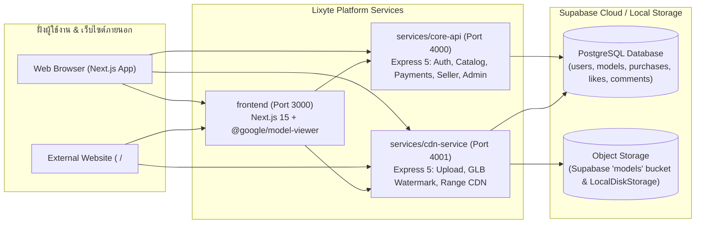

# Lixyte (Broken Design) — 3D Asset Repository & Cross-Origin WebGL CDN Platform

**Lixyte** (เดิมชื่อ **Broken Design**) คือแพลตฟอร์ม **"Google Fonts สำหรับโลก 3 มิติ"** — ศูนย์กลางในการจัดเก็บ ค้นหา ซื้อขายรายชิ้น และสตรีมไฟล์โมเดล 3 มิติมาตรฐาน `.glb` (Binary glTF 2.0) ข้ามโดเมน (Cross-Origin CDN) สำหรับนักพัฒนาเว็บและครีเอเตอร์ 3 มิติ

นักพัฒนาเว็บสามารถค้นหาโมเดล ปรับแต่งมุมมองใน Playground แล้วคัดลอกโค้ดเพียง 1–2 บรรทัด (`<vm-model>` Web Component หรือ `<iframe>`) ไปวางบนเว็บไซต์ของตนเองเพื่อให้โมเดลสตรีมจาก CDN ของ Lixyte โดยตรง ไม่ต้องดาวน์โหลด ไม่ต้องตั้งค่า CORS/Cache เอง และไม่ต้องแบกภาระแบนด์วิดท์ของไฟล์ 3 มิติขนาดใหญ่ หรือเลือกดาวน์โหลดไฟล์ `.glb` ที่ฝังใบอนุญาตและลายน้ำดิจิทัล (Multi-Layer Watermark) ไปใช้งานต่อได้ทันที

> 🤖 **สำหรับ AI Coding Agents (Antigravity, Gemini, Claude, Cursor, Copilot, Codex):**
> โปรเจกต์นี้ใช้ **[AGENT.md](./AGENT.md)** เป็นเอกสารกำหนดสถาปัตยกรรม กฎเหล็กด้านความปลอดภัย และเส้นทางการพัฒนา (Development Roadmap) โดยมีการผูกกฎบังคับอ่านอัตโนมัติไว้ใน [GEMINI.md](./GEMINI.md), [AGENTS.md](./AGENTS.md), และ [.agents/rules/mandatory-agent-spec.md](./.agents/rules/mandatory-agent-spec.md)

---

## สารบัญ (Table of Contents)

1. [จุดเด่นและฟีเจอร์หลัก (Key Features)](#1-จุดเด่นและฟีเจอร์หลัก-key-features)
2. [สถาปัตยกรรมระบบ Microservices (System Architecture)](#2-สถาปัตยกรรมระบบ-microservices-system-architecture)
3. [บทบาทผู้ใช้และตารางสิทธิ์การเข้าถึง (Roles & Access Control Matrix)](#3-บทบาทผู้ใช้และตารางสิทธิ์การเข้าถึง-roles--access-control-matrix)
4. [ระบบฝังใบอนุญาตและลายน้ำ 2 ชั้นในไฟล์ .glb (Multi-Layer GLB Watermarking)](#4-ระบบฝังใบอนุญาตและลายน้ำ-2-ชั้นในไฟล์-glb-multi-layer-glb-watermarking)
5. [โครงสร้างโฟลเดอร์โปรเจกต์ (Project Structure)](#5-โครงสร้างโฟลเดอร์โปรเจกต์-project-structure)
6. [รายละเอียด API Endpoints & การฝังโมเดล (API & Embed Reference)](#6-รายละเอียด-api-endpoints--การฝังโมเดล-api--embed-reference)
7. [การแบ่งงานภายในทีมผู้พัฒนา 6 คน (Team Responsibilities)](#7-การแบ่งงานภายในทีมผู้พัฒนา-6-คน-team-responsibilities)
8. [วิธีติดตั้งและเริ่มต้นใช้งาน (Getting Started & Testing)](#8-วิธีติดตั้งและเริ่มต้นใช้งาน-getting-started--testing)

---

## 1. จุดเด่นและฟีเจอร์หลัก (Key Features)

- **Plug-and-Play Cross-Origin 3D Embed:** ฝังโมเดล 3 มิติข้ามโดเมนด้วย Web Component `<vm-model>` (`public/embed.js`) หรือ `<iframe>` (`/embed/[id]`) รองรับการปรับ `auto-rotate`, `camera-controls`, `exposure`, `shadow-intensity` และพื้นหลัง
- **Graceful Preview Fallback:** สำหรับโมเดลเสียเงิน หากไม่ได้ใส่ `embed_key` หรือคีย์ถูกยกเลิก (Regenerate) ตัว Viewer บนเว็บปลายทางจะสลับไปสตรีมไฟล์ตัวอย่าง (`preview.glb`) พร้อมแสดงป้ายแจ้งเตือน `"ต้องซื้อเพื่อใช้งาน"` อัตโนมัติโดยไม่ทำให้หน้าเว็บปลายทางพัง
- **High-Performance 3D CDN Streaming:** รองรับ `HTTP Range Requests` (`206 Partial Content` / `416 Range Not Satisfiable`), `ETag` (`304 Not Modified`), `Cache-Control: immutable` สำหรับไฟล์ที่อ้างอิงด้วย SHA-256 Hash และ `Cross-Origin-Resource-Policy: cross-origin`
- **Single-Item Purchase & Instant Key Regeneration:** ระบบซื้อโมเดลรายชิ้นที่ล็อกราคา (`amount_cents`), สกุลเงิน (`currency`), และประเภทใบอนุญาต (`license_type`) ณ เวลาที่ซื้อ พร้อมสร้าง `embed_key` แบบสุ่มปลอดภัย (`crypto.randomBytes(24)`) ที่ตรวจสอบด้วย Constant-Time (`crypto.timingSafeEqual`) และสามารถกด Regenerate เพื่อตัดสิทธิ์คีย์เก่าได้ทันที
- **Multi-Layer GLB Watermarking (Metadata + Vertex Steganography):** ฝังลายน้ำดิจิทัล 2 ชั้นลงในไฟล์ `.glb` ทั้งตอนอัปโหลดต้นฉบับและตอนผู้ซื้อดาวน์โหลด ช่วยพิสูจน์ความเป็นเจ้าของได้แม้ผู้ไม่หวังดีจะลบ Metadata ออกจากไฟล์แล้วนำไป Export ใหม่
- **Dual-Mode Storage & Database Resilience:** รองรับการจัดเก็บไฟล์แบบ Content-Addressable (`<sha256>.glb`, `<sha256>.webp`) ทั้งบน `LocalDiskStorage` และ `SupabaseStorage` (`models` bucket) พร้อมระบบสลับการเชื่อมต่อฐานข้อมูลระหว่าง PostgreSQL Pool และ Supabase REST API อัตโนมัติ

---

## 2. สถาปัตยกรรมระบบ Microservices (System Architecture)

โปรเจกต์ **Lixyte** แยกส่วน Backend ออกเป็น **2 Microservices** ตามลักษณะการใช้ทรัพยากร เพื่อป้องกันไม่ให้การอัปโหลด ประมวลผลลายน้ำ 3 มิติ และสตรีมไฟล์ `.glb` ขนาดใหญ่กระทบต่อความเร็วของระบบ API หลัก:



| เซอร์วิส / โฟลเดอร์ | พอร์ต | เทคโนโลยีหลัก | หน้าที่รับผิดชอบ |
| :--- | :---: | :--- | :--- |
| **`frontend/`** | `3000` | Next.js 15 (App Router), React 19, Tailwind CSS 3, `@google/model-viewer` v4 | หน้าเว็บ Gallery, หน้ารายละเอียด `/models/[id]` + 3D Playground, หน้าอัปโหลด `/upload` (จับภาพ `poster.webp` อัตโนมัติด้วย `.toBlob()`), หน้า `/embed/[id]`, สคริปต์ `public/embed.js` (`<vm-model>`), หน้า `/me`, `/seller`, และ `/admin/*` |
| **`services/core-api/`** | `4000` | Express 5, TypeScript, PostgreSQL (`pg`), JWT, `bcrypt`, `zod` | ระบบสมาชิก (`/api/auth/*`), แคตตาล็อกและการค้นหา (`/api/models/*`), ระบบซื้อรายชิ้นและจัดการ `embed_key` (`/api/models/:id/checkout`, `/api/me/purchases`), ระบบคนขาย (`/api/seller/*`) และระบบแอดมิน (`/api/admin/*`) |
| **`services/cdn-service/`** | `4001` | Express 5, TypeScript, `multer`, `@gltf-transform/core`, `@supabase/supabase-js` | รับอัปโหลดไฟล์ `.glb` (≤ 50 MB), ตรวจ Magic Bytes (`glTF` v2), ฝัง/ตรวจลายน้ำ 2 ชั้น (`glbWatermark.ts`), เก็บไฟล์ด้วย `sha256` และสตรีมผ่าน `/cdn/models/*` (HTTP Range, ETag, CORS, Rate Limit) |
| **`supabase/`** | `5432` | Supabase PostgreSQL & Supabase Storage | ฐานข้อมูลหลัก (`users`, `models`, `purchases`, `likes`, `comments`) และ Cloud Object Storage (`models` bucket) |

---

## 3. บทบาทผู้ใช้และตารางสิทธิ์การเข้าถึง (Roles & Access Control Matrix)

ลูกค้า (ผู้ซื้อ/นักพัฒนาเว็บ) และคนขาย (ครีเอเตอร์) ใช้ **บัญชีเดียวกัน** โดยสามารถกดเปิด "โหมดคนขาย" (`is_seller = true`) เพิ่มเติมได้ทันที ส่วนแอดมินตั้งค่าในฐานข้อมูลเท่านั้นและห้ามซื้อหรือขายโมเดล

| บทบาท | วิธีได้สิทธิ์ | สิทธิ์การใช้งานในระบบ |
| :--- | :--- | :--- |
| **ลูกค้า (Buyer / Dev)** | สมัครสมาชิกปกติ | ค้นหาโมเดลใน Gallery, ปรับแต่งและคัดลอกโค้ดฝัง (`<vm-model>` / `<iframe>`), ซื้อโมเดลรายชิ้น, ดาวน์โหลดไฟล์ `.glb`, จัดการ `embed_key` ในหน้า `/me` |
| **คนขาย (Creator / Seller)** | กดเปิด "โหมดคนขาย" ในบัญชีเดิม | ทุกอย่างของลูกค้า + อัปโหลดโมเดล `.glb` (ฟรีหรือตั้งราคาขาย), ลบโมเดลของตัวเอง (Soft Delete), ดูรายการโมเดลและสรุปยอดขายใน `/seller` |
| **แอดมิน (Admin)** | ตั้งค่า `role = 'admin'` ในฐานข้อมูลเท่านั้น | ดูแลระบบผ่าน `/admin/*`: ดูภาพรวม, ซ่อน/คืนโมเดลที่ละเมิดกฎ (`hidden_at`), ระงับ/คืนบัญชีผู้ใช้ (`suspended_at`), ดูรายการสั่งซื้อทั้งระบบ |

### ตารางสิทธิ์การเข้าถึงไฟล์บน CDN (CDN Access Control Matrix)

| ประเภท / สถานะโมเดล | แสดงใน Gallery | สตรีมผ่าน `/preview.glb` หรือ `/:hash.glb` | สตรีมไฟล์เต็มผ่าน `/file.glb?key=` | ดาวน์โหลดไฟล์จริงผ่าน `/download` |
| :--- | :--- | :--- | :--- | :--- |
| **โมเดลฟรี (`price_cents = 0`)** | แสดงทุกคน | ทุกคน (ส่งไฟล์เต็ม) | ทุกคน (ไม่ต้องใช้ `key`) | ทุกคน (ไม่ต้องล็อกอิน) |
| **โมเดลเสียเงิน (`price_cents > 0`)** | แสดงทุกคน | ทุกคน (ส่งเฉพาะไฟล์ `preview` เท่านั้น บล็อก `file_hash` ด้วย `401 KEY_REQUIRED`) | เฉพาะผู้มี `embed_key` ที่ชำระเงินแล้ว (`status = 'paid'`) และตรงกับโมเดล | ต้องล็อกอิน (`Bearer JWT`) + ซื้อแล้ว (`status = 'paid'`) หรือเป็นเจ้าของโมเดล |
| **ถูกลบโดยเจ้าของ (`deleted_at`)** | ไม่แสดง (`404`) | ปิดกั้น (`404 MODEL_NOT_FOUND`) | **ผู้ซื้อเดิมยังสตรีมได้ปกติ** (Soft Delete) | **ผู้ซื้อเดิม/เจ้าของยังดาวน์โหลดได้** |
| **ถูกซ่อนโดยแอดมิน (`hidden_at`)** | ไม่แสดง | **ปิดกั้นทันที (`403 MODEL_UNAVAILABLE`)** | **ปิดกั้นทันที (`403`) แม้ซื้อแล้ว** | **ปิดกั้นทันที (`403`) แม้ซื้อแล้ว** |
| **เจ้าของถูกระงับ (`suspended_at`)** | ไม่แสดง | **ปิดกั้นทันที (`403 MODEL_UNAVAILABLE`)** | **ปิดกั้นทันที (`403`) แม้ซื้อแล้ว** | **ปิดกั้นทันที (`403`) แม้ซื้อแล้ว** |

---

## 4. ระบบฝังใบอนุญาตและลายน้ำ 2 ชั้นในไฟล์ `.glb` (Multi-Layer GLB Watermarking)

เพื่อปกป้องทรัพย์สินทางปัญญาของครีเอเตอร์และตรวจสอบแหล่งที่มาของไฟล์ `.glb` ที่ถูกดาวน์โหลดออกไป เซอร์วิส `cdn-service` (`src/utils/glbWatermark.ts`) ใช้ไลบรารี `@gltf-transform/core` ฝังลายน้ำดิจิทัล **2 ชั้น (Dual-Layer Protection)**:

1. **Layer 1 — Cryptographic Metadata Signature (`asset.extras` & `asset.copyright`):**
   - คำนวณรหัสลายเซ็น `signature` ด้วย `HMAC-SHA256` ร่วมกับ `WATERMARK_SECRET`
   - ฝังข้อมูล `{ platform: 'Broken Design', modelId, ownerId, license, purchaseId, signature, issuedAt }` ลงใน `asset.extras` และข้อความลิขสิทธิ์ใน `asset.copyright`
   - ตอนครีเอเตอร์อัปโหลดโมเดล ระบบจะฝัง `purchaseId: 'original'` เป็นลายน้ำต้นฉบับ และเมื่อผู้ซื้อกดดาวน์โหลด ระบบจะฝัง `purchaseId` และ `license_type` ของผู้ซื้อรายนั้นลงในไฟล์ `.glb` พร้อมบันทึกค่า `watermark_hash` ลงในตาราง `purchases`
2. **Layer 2 — 3D Vertex Steganography (`POSITION` Accessor):**
   - ดึงพิกัดจุดยอด (`POSITION` accessor) ของ Mesh แรกในไฟล์ `.glb` จำนวน 64 จุดแรก
   - นำบิต 64 บิตแรกของ `signature` ไปปรับค่าทศนิยมหลักที่ 4 ของพิกัดแกน X (`Math.round(x * 10000)`) ให้เป็นเลขคู่ (`0`) หรือเลขคี่ (`1`) โดยคำนวณแบบ `Float32`-safe
   - การขยับพิกัดเพียง `±0.0001` หน่วยไม่ส่งผลต่อรูปทรงเรขาคณิตเมื่อมองด้วยตาเปล่าใน Three.js หรือ `<model-viewer>` แต่ช่วยให้ระบบยังสามารถพิสูจน์ความเป็นเจ้าของโมเดลได้ผ่าน `POST /cdn/verify-watermark` แม้ว่าผู้ไม่หวังดีจะลบ `asset.extras` ออกจากการนำไฟล์ไป Export ใหม่ในโปรแกรม 3 มิติ

---

## 5. โครงสร้างโฟลเดอร์โปรเจกต์ (Project Structure)

```text
broken-design/
├── .agents/
│   └── rules/
│       └── mandatory-agent-spec.md       # กฎบังคับให้ AI Agent อ่าน AGENT.md ก่อนทำงานทุกครั้ง
├── services/
│   ├── core-api/                         # [Microservice 1] Core Business Logic API (Port 4000)
│   │   ├── src/
│   │   │   ├── config/                   # ตั้งค่าการเชื่อมต่อ PostgreSQL DB และ Environment Variables
│   │   │   ├── middlewares/              # JWT Auth, ตรวจบทบาท (requireSeller / requireAdmin), Error Handler  [แฮม]
│   │   │   ├── modules/
│   │   │   │   ├── auth/                 # สมัครสมาชิก, ล็อกอิน (bcrypt + JWT), บล็อกบัญชีที่ถูกระงับ  [ต้า]
│   │   │   │   ├── models/               # ดึงรายการ, ค้นหา, กรอง, แบ่งหน้า, รายละเอียด, Soft Delete  [เป้ก / แฮม]
│   │   │   │   ├── payments/             # ซื้อรายชิ้นจำลอง, ล็อกราคา/License, สร้าง/Regenerate embed_key + Tests  [ภีม]
│   │   │   │   ├── seller/               # ยอดขาย, โมเดลของคนขาย, เปิดโหมดคนขาย + Tests  [ภีม]
│   │   │   │   ├── admin/                # ภาพรวม, ซ่อน/คืนโมเดล, ระงับ/คืนบัญชี, รายการซื้อขาย  [ต้า / เป้ก]
│   │   │   │   └── interactions/         # ถูกใจและความคิดเห็น (Likes/Comments)
│   │   │   ├── scripts/
│   │   │   │   └── seedAdmin.ts          # สคริปต์สร้างบัญชี Admin และ Creator เริ่มต้น  [แฮม]
│   │   │   └── app.ts                    # Entry point ของ Core API (/api/*)
│   │   ├── .env.example
│   │   ├── Dockerfile
│   │   └── package.json
│   │
│   └── cdn-service/                      # [Microservice 2] High-I/O Upload, Watermark & 3D Streaming CDN (Port 4001)
│       ├── src/
│       │   ├── config/                   # ตั้งค่า DB (PostgreSQL + Supabase REST Fallback), Env, Supabase Client
│       │   ├── middlewares/              # JWT Auth (requireAuth / requireSeller / requireAdmin) & Error Handler  [แฮม]
│       │   ├── storage/                  # StorageAdapter, LocalDiskStorage & SupabaseStorage (sha256)  [แฮม / นนท์]
│       │   ├── utils/
│       │   │   ├── glbValidator.ts       # ตัวตรวจ Magic Bytes ของไฟล์ .glb (glTF v2) และการคำนวณ SHA-256  [แฮม]
│       │   │   └── glbWatermark.ts       # ระบบฝังและตรวจลายน้ำ 2 ชั้น (Metadata HMAC + Vertex Steganography)
│       │   ├── modules/
│       │   │   ├── upload/               # รับไฟล์ .glb, ฝังลายน้ำต้นฉบับ, บันทึกลง Storage + DB  [แฮม]
│       │   │   └── cdn/                  # สตรีมไฟล์ .glb/.webp, ตรวจ embed_key, ฝังลายน้ำผู้ซื้อ, Range, Cache  [นนท์]
│       │   │       ├── cdn.routes.ts     #   Routes ของ /cdn/models/* และ POST /cdn/verify-watermark
│       │   │       ├── cdn.service.ts    #   ตรวจสิทธิ์, ตรวจ embed_key, บันทึก watermark_hash และส่งสตรีม
│       │   │       ├── range.ts          #   ตัวแปลง HTTP Range Header (RFC 9110 §14)
│       │   │       └── cdn.test.ts       #   ชุดทดสอบ CDN & Watermark ครบทุกเงื่อนไข (23 test cases)
│       │   └── app.ts                    # Entry point ของ CDN Service (/api/models, /cdn/*, /verify-watermark)
│       ├── .env.example
│       ├── Dockerfile
│       └── package.json
│
├── frontend/                             # Next.js 15 Frontend & WebGL Viewer (Port 3000)
│   ├── public/
│   │   └── embed.js                      # Web Component <vm-model> พร้อมระบบสลับไป preview เมื่อ key ผิด  [เจี๊ยบ / นนท์]
│   ├── src/
│   │   ├── app/
│   │   │   ├── page.tsx                  # หน้าแรก Landing & Featured 3D Models
│   │   │   ├── gallery/page.tsx          # หน้า Gallery ค้นหาและกรองโมเดล
│   │   │   ├── login/page.tsx            # หน้าเข้าสู่ระบบและสมัครสมาชิก
│   │   │   ├── upload/page.tsx           # หน้าอัปโหลด .glb + สร้างภาพ Poster ด้วย .toBlob()  [แฮม]
│   │   │   ├── me/page.tsx               # รายการที่ซื้อ, embed_key, ปุ่ม Regenerate Key
│   │   │   ├── models/[id]/page.tsx      # หน้ารายละเอียด + 3D Preview + Embed Snippets + ปุ่มซื้อ/ดาวน์โหลด
│   │   │   ├── creators/[handle]/page.tsx# หน้าโปรไฟล์ครีเอเตอร์
│   │   │   └── embed/[id]/page.tsx       # หน้า Viewer สำหรับ Iframe (CSP frame-ancestors *)  [นนท์]
│   │   ├── components/
│   │   │   ├── gallery/                  # การ์ดโมเดลและตัวกรอง
│   │   │   ├── model/                    # ModelPreview (3D CDN), ModelActions (Download/Buy), EmbedSnippets
│   │   │   └── viewer/                   # 3D Canvas Viewer & EmbedIframeViewer
│   │   └── lib/
│   │       └── api.ts                    # เชื่อมต่อ Supabase REST, CORE_API_URL และ CDN_SERVICE_URL
│   ├── next.config.ts
│   ├── .env.example
│   ├── Dockerfile
│   └── package.json
│
├── supabase/
│   └── schema.sql                        # สคริปต์สร้างตาราง users, models, purchases, likes, comments + Seed
├── docker-compose.yml                    # รันทุก Microservices พร้อมกันด้วยคำสั่งเดียว
├── AGENT.md                              # คู่มือสถาปัตยกรรมและแผนที่นำทาง (Roadmap) สำหรับ AI Agent ทุกตัว
├── AGENTS.md                             # ตัวชี้กฎมาตรฐานสำหรับ OpenAI Codex / Cursor / Windsurf Agents
├── CLAUDE.md                             # ตัวชี้กฎมาตรฐานสำหรับ Claude Code Agent
├── GEMINI.md                             # ตัวชี้กฎมาตรฐานสำหรับ Google Antigravity / Gemini Agent
└── README.md                             # เอกสารคู่มือหลักสำหรับผู้สนใจและผู้ร่วมพัฒนา
```

---

## 6. รายละเอียด API Endpoints & การฝังโมเดล (API & Embed Reference)

### 6.1 CDN Service (`http://localhost:4001`)

| Method & Path | การยืนยันตัวตน | Cache-Control | รายละเอียดการทำงาน |
| :--- | :--- | :--- | :--- |
| `POST /api/models` | `Bearer JWT` (Seller) | `no-store` | อัปโหลดไฟล์ `file` (`.glb` ≤ 50 MB), `preview` (`.glb` ≤ 5 MB, บังคับถ้ามีราคา), `poster` (`.webp/.png/.jpg` ≤ 1 MB) พร้อมฝังลายน้ำต้นฉบับ (`purchaseId: 'original'`) |
| `GET /cdn/models/:id/:hash.glb` | Public | `public, max-age=31536000, immutable` | สตรีมไฟล์ตามค่า SHA-256 (เฉพาะไฟล์ของโมเดลฟรี หรือไฟล์ `preview` ของโมเดลเสียเงิน) รองรับ HTTP Range (`206`/`416`) |
| `GET /cdn/models/:id/preview.glb` | Public | `public, max-age=300` | สตรีมไฟล์ตัวอย่างสำหรับแสดงผลสาธารณะ (โมเดลฟรีส่งไฟล์เต็ม โมเดลเสียเงินส่งไฟล์ preview) |
| `GET /cdn/models/:id/file.glb?key=` | `embed_key` (สำหรับโมเดลเสียเงิน) | `private, no-store` | ตรวจ `embed_key` ด้วย `crypto.timingSafeEqual` กับตาราง `purchases (status='paid')` ก่อนสตรีมไฟล์เต็ม |
| `GET /cdn/models/:id/download` | `Bearer JWT` (สำหรับโมเดลเสียเงิน) | `private, no-store` | ดาวน์โหลดไฟล์ `.glb` (สำหรับผู้ซื้อจะฝัง `purchaseId` + `license_type` ลงในไฟล์และบันทึก `watermark_hash` ลงตาราง `purchases`) พร้อมนับ `download_count + 1` |
| `GET /cdn/models/:id/poster.webp` | Public | `public, max-age=300` | สตรีมภาพหน้าปกของโมเดล (`image/webp`) |
| `POST /cdn/verify-watermark` | Public | `no-store` | รับไฟล์ `.glb` ต้องสงสัย (`multipart/form-data` หรือ `model/gltf-binary`) เพื่อตรวจสอบลายน้ำทั้งจาก `asset.extras` และพิกัด `POSITION` 64 จุดแรก |

### 6.2 Core API (`http://localhost:4000`)

| หมวดหมู่ | Method & Path | รายละเอียดการทำงาน |
| :--- | :--- | :--- |
| **Auth** | `POST /api/auth/register` | สมัครสมาชิกใหม่ (เข้ารหัสรหัสผ่านด้วย `bcrypt` และคืนค่า JWT) |
| **Auth** | `POST /api/auth/login` | เข้าสู่ระบบ (ตรวจสอบรหัสผ่าน และบล็อกบัญชีที่มี `suspended_at` ด้วย `403 ACCOUNT_SUSPENDED`) |
| **Models** | `GET /api/models` | ดึงรายการโมเดล ค้นหา (`q`), กรองตาม `tag`, `license`, `price=free\|paid` และแบ่งหน้า (`page`) |
| **Models** | `GET /api/models/:id` | ดึงข้อมูลรายละเอียดโมเดล (ซ่อนลิงก์ไฟล์จริงหากเป็นโมเดลเสียเงิน) |
| **Models** | `DELETE /api/models/:id` | ลบโมเดลแบบ Soft Delete (`deleted_at = NOW()`) เฉพาะเจ้าของหรือแอดมิน |
| **Payments** | `POST /api/models/:id/checkout` | สร้างคำสั่งซื้อรายชิ้น (`pending`) ล็อก `amount_cents`, `currency`, `license_type` และสุ่ม `embed_key` 48 ตัวอักษร hex |
| **Payments** | `POST /api/purchases/:id/confirm-mock` | ยืนยันการชำระเงินจำลอง (`status = 'paid'`, `paid_at = NOW()`) เฉพาะเมื่อ `PAYMENT_PROVIDER=mock` |
| **Payments** | `GET /api/me/purchases` | ดึงรายการโมเดลที่ซื้อสำเร็จพร้อม `embed_key`, ราคาที่ซื้อ, ประเภท License และ `watermark_hash` |
| **Payments** | `POST /api/purchases/:id/regenerate-key` | สุ่ม `embed_key` ใหม่และยกเลิกสิทธิ์ของคีย์เก่าทันที |
| **Seller** | `POST /api/seller/enable` | เปิดโหมดคนขาย (`is_seller = true`) ให้บัญชีปัจจุบัน |
| **Seller** | `GET /api/seller/models` & `/sales` | ดูรายการโมเดลของตัวเองและสรุปยอดขายทั้งหมด |

### 6.3 การฝังโมเดลข้ามโดเมน (Cross-Origin Embed Contract)

นักพัฒนาสามารถฝังโมเดล 3 มิติลงในเว็บไซต์ภายนอกได้ 2 รูปแบบ:

1. **Web Component (`<vm-model>`)**:
   ```html
   <script type="module" src="http://localhost:3000/embed.js"></script>
   <vm-model
     model-id="7524b129-938b-41c9-b66c-977a809e1c89"
     cdn-base="http://localhost:4001"
     key="YOUR_EMBED_KEY"
     auto-rotate
     camera-controls
   ></vm-model>
   ```
   *(สำหรับโมเดลฟรีไม่ต้องใส่ attribute `key` หากใส่ `key` ของโมเดลเสียเงินผิดหรือคีย์ถูก Regenerate ไปแล้ว ตัว Viewer จะสลับไปโหลดไฟล์ `preview.glb` พร้อมแสดงข้อความแจ้งเตือน `"ต้องซื้อเพื่อใช้งาน"` อัตโนมัติโดยไม่ทำให้หน้าเว็บพัง)*

2. **Iframe (`/embed/[id]`)**:
   ```html
   <iframe
     src="http://localhost:3000/embed/7524b129-938b-41c9-b66c-977a809e1c89?key=YOUR_EMBED_KEY"
     width="600"
     height="400"
     loading="lazy"
     allow="fullscreen"
     style="border:0"
   ></iframe>
   ```

---

## 7. การแบ่งงานภายในทีมผู้พัฒนา 6 คน (Team Responsibilities)

| สมาชิก | บทบาทและความรับผิดชอบหลัก | พื้นที่รับผิดชอบในโค้ดเบส |
| :--- | :--- | :--- |
| **เจี๊ยบ** (คู่ภีม) | หน้าเว็บ Frontend หลัก: Web Component `<vm-model>`, หน้าแรก Gallery, หน้ารายละเอียด + Embed Playground, หน้าล็อกอิน/สมัคร, หน้า `/me`, และ **แดชบอร์ดแอดมินทั้ง 4 หน้า** | `frontend/` (ยกเว้น `pay/mock/` และ `seller/`) |
| **ภีม** (คู่เจี๊ยบ) | ระบบซื้อขายรายชิ้นจำลอง (`checkout`, ยืนยันจ่าย, สร้าง/Regenerate `embed_key`, รายการที่ซื้อ), หน้าจ่ายเงินจำลอง, และแดชบอร์ดคนขาย (โมเดลของฉัน ยอดขาย ปุ่มเปิดโหมดคนขาย) | `services/core-api/src/modules/payments/`, `seller/`<br>`frontend/src/app/pay/`, `seller/` |
| **นนท์** (คู่เป้ก) | ระบบ CDN & Watermark: สตรีมไฟล์โมเดล/ภาพปก, ตรวจ `embed_key` แบบ Constant-Time, ฝังและตรวจลายน้ำ 2 ชั้นในไฟล์ `.glb`, HTTP Range, Cache, Rate limit, เชื่อมต่อ CDN เข้ากับ Supabase & Frontend | `services/cdn-service/src/modules/cdn/`, `utils/glbWatermark.ts`<br>`frontend/src/app/embed/`, `components/model/` |
| **แฮม** (คู่ต้า) | โครงสร้างฐานข้อมูล `schema.sql`, Middlewares ตรวจสิทธิ์และรูปแบบ Error, `StorageAdapter` (`LocalDiskStorage` / `SupabaseStorage`), ตรวจ Magic Bytes ของ `.glb`, รับอัปโหลดโมเดล + สร้าง Poster, ลบโมเดล (Soft Delete) | `supabase/`<br>`services/core-api/src/middlewares/`<br>`services/cdn-service/src/storage/`, `utils/glbValidator.ts`, `modules/upload/` |
| **ต้า** (คู่แฮม) | ระบบสมาชิก (`register` / `login` ด้วย `bcrypt` + JWT, บล็อกบัญชีที่ถูกระงับ), และส่วน Backend ของหน้าจัดการผู้ใช้ในแดชบอร์ดแอดมิน (ดึงรายชื่อ ระงับ/คืนบัญชี) | `services/core-api/src/modules/auth/`<br>`services/core-api/src/modules/admin/` (ส่วนผู้ใช้) |
| **เป้ก** (คู่นนท์) | ระบบแคตตาล็อกโมเดล: ดึงรายการ/ค้นหา/กรอง/แบ่งหน้า/รายละเอียดโมเดล (กรองโมเดลที่ซ่อนหรือลบ และไม่ส่งลิงก์ไฟล์เต็มของโมเดลเสียเงิน) และส่วนแอดมินจัดการโมเดล/รายการสั่งซื้อ | `services/core-api/src/modules/models/`<br>`services/core-api/src/modules/admin/` (ส่วนโมเดลและรายการซื้อ) |

---

## 8. วิธีติดตั้งและเริ่มต้นใช้งาน (Getting Started & Testing)

### 8.1 ขั้นตอนการติดตั้ง
1. **Clone โปรเจกต์และติดตั้ง Dependencies:**
   ```bash
   git clone https://github.com/TuraHot/broken-design.git
   cd broken-design

   cd services/core-api && npm install
   cd ../cdn-service && npm install
   cd ../../frontend && npm install
   ```
2. **ตั้งค่าฐานข้อมูลและ Storage บน Supabase:**
   - นำสคริปต์ใน [`supabase/schema.sql`](./supabase/schema.sql) ไปรันใน **SQL Editor** ของ Supabase เพื่อสร้างตารางและบัญชีตัวอย่าง
   - สร้าง Storage Bucket ชื่อ `models` บน Supabase Storage สำหรับจัดเก็บไฟล์ `.glb` และ `.webp`
3. **ตั้งค่าไฟล์ Environment (`.env`):**
   - คัดลอก `.env.example` เป็น `.env` ใน `services/core-api/` และ `services/cdn-service/` (และ `.env.local` ใน `frontend/`)
   - กำหนดค่า `DATABASE_URL`, `SUPABASE_URL`, `SUPABASE_KEY`, `JWT_SECRET`, และ `WATERMARK_SECRET` (ห้ามนำไฟล์ `.env` ขึ้น Git)

### 8.2 บัญชีทดสอบเริ่มต้น (Default Seed Accounts)
- **Admin:** `admin@brokendesign.com` / รหัสผ่าน: `Admin@BrokenDesign2026!`
- **Creator (คนขาย):** `creator@brokendesign.com` / รหัสผ่าน: `Creator@BrokenDesign2026!`
- **โมเดล 3D ตัวอย่างบน Supabase:** ID `7524b129-938b-41c9-b66c-977a809e1c89` (`Lixyte Crystal Cube`)

### 8.3 การรันระบบและการทดสอบ (Running & Testing)
- **รันทุกเซอร์วิสพร้อมกันด้วย Docker Compose:**
  ```bash
  docker compose up --build
  ```
- **หรือรันแยกแต่ละเซอร์วิสในโหมดพัฒนา (`npm run dev`):**
  - `frontend`: `http://localhost:3000`
  - `services/core-api`: `http://localhost:4000`
  - `services/cdn-service`: `http://localhost:4001`
- **รันชุดทดสอบอัตโนมัติ (Unit & Integration Tests):**
  ```bash
  # 1. ทดสอบ CDN Service & Multi-Layer GLB Watermarking (23 test cases)
  cd services/cdn-service
  npx tsc --noEmit -p .
  npm test

  # 2. ทดสอบ Core API — Payments & Seller (17 test cases)
  cd services/core-api
  npx tsc --noEmit -p .
  npm test

  # 3. ตรวจสอบ Type-Check ของฝั่ง Frontend
  cd frontend
  npx tsc --noEmit -p .
  ```
